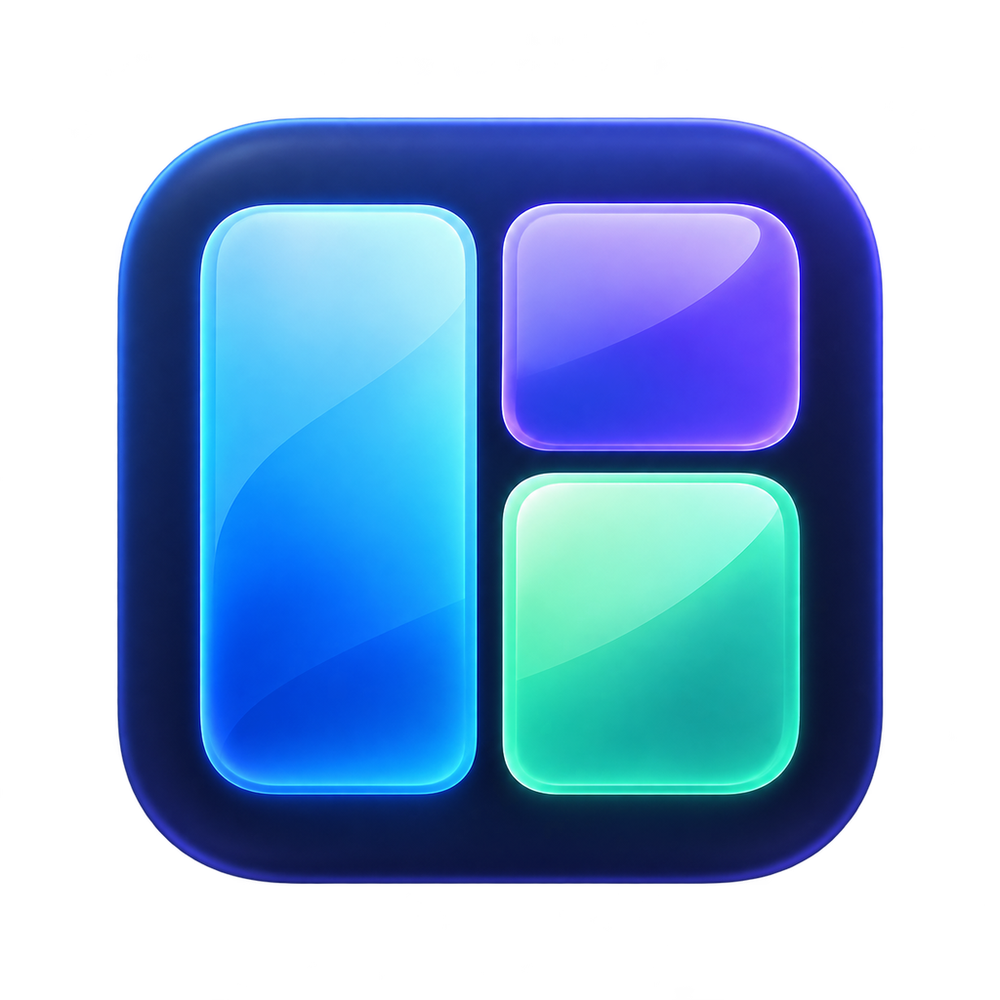

<p align="center">
  
</p>

# HyperMac

**A place for every window.**

HyperMac is a native macOS window manager that automatically arranges your apps, saves layouts for different setups, and puts window controls and app launchers on customizable keyboard shortcuts.

> **0.6.2 · Development preview · Apple Silicon only.** Intel support has been retired. Clean-Mac installation and the full window-management compatibility matrix are still being validated. Preview DMGs are ad-hoc signed; there is **no notarized production release**. See [release readiness](RELEASE-READINESS.md) for the remaining work.

## Feature tour


A captioned tour of the interface, including a labeled monitor-profile illustration. This is a screenshot walkthrough, not a live animation recording. [Browse the screenshots and capture notes](docs/media/README.md).

## What you can do

- **Tile automatically:** opening, closing, minimizing or restoring eligible windows redistributes available space. Dynamic splits is the default for new configurations.
- **Keep selected apps floating:** choose apps from Applications in the exclusions list. System Settings is excluded by default.
- **Customize borders and transitions:** light-green borders by default, adjustable width and color, and eased movement that respects Reduce Motion.
- **Create saved layouts:** drag apps onto monitor previews, resize their rectangles, duplicate layouts, or capture your current arrangement.
- **Use adaptive layouts:** let the open windows listed in a saved layout share the available space.
- **Undo and redo an arrangement:** restore one previous arrangement of surviving windows.
- **Record shortcuts:** press a combination and select launch targets with an application picker.
- **Switch layouts when docking:** save monitor profiles for your connected display setups.
- **Resize with the mouse:** in automatic Dynamic splits mode, drag a normal window edge or corner to adjust neighboring tiles when you release it.

## Requirements

- macOS **14 or later**, on **Apple Silicon (M1 or newer)**. This is the declared minimum; not every supported macOS version has been tested.
- Accessibility permission so HyperMac can move and resize windows.
- Xcode Command Line Tools for the current source installation process. Full Xcode is needed to run XCTest.
- Access to this private GitHub repository to download source or clone it.

Karabiner-Elements is optional. If you already map Caps Lock to Hyper, that mapping works with HyperMac's Hyper shortcuts.

## Preview downloads

Authorized repository users can run **Actions → Apple Silicon preview DMG → Run workflow**. The default creates a downloadable build artifact. Enable **Publish an unnotarized prerelease** on `main` to attach the DMG and SHA-256 checksum to [Releases](https://github.com/c0dewars/HyperMac/releases). Private repository access is required.

These are development previews: Gatekeeper may block them, and replacing a locally signed copy may require refreshing Accessibility permission. Source installation below preserves a stable local signing identity.

## Install from source

This is currently a developer/tester installation. Each Mac creates its own local signing identity; this does not produce an Apple-notarized release for redistribution.

1. Sign into GitHub, open [HyperMac](https://github.com/c0dewars/HyperMac), and choose **Code → Download ZIP**. Extract the ZIP outside Trash. Alternatively, clone the repository using your GitHub credentials.
2. Install Command Line Tools if needed:

   ```sh
   xcode-select --install
   ```

   Complete installation before continuing.
3. Open Terminal in the extracted project folder. Quit an existing HyperMac instance, then run:

   ```sh
   bash scripts/setup-local-signing.sh
   bash scripts/build.sh
   ```

   The setup script creates a signing certificate in your login Keychain. Authenticate directly in macOS if prompted. Keep this identity for future updates; do not share its private key.
4. The build script installs and opens the app, using `/Applications` or `~/Applications`. Keep the app in that location.
5. Open **System Settings → Privacy & Security → Accessibility**. Add the installed HyperMac app and enable its switch. HyperMac's General tab shows the exact installed path if needed.

Automatic tiling is enabled by default for new configurations. Existing settings are preserved. Screen Recording permission is not requested.

### Update an existing installation

Download the updated source, quit HyperMac, and run `bash scripts/build.sh` from the new project folder. Reuse the signing identity on that Mac. The installer checks signing continuity; do not delete the certificate or regenerate it for each update.

## Your first workspace

Open HyperMac from Applications to show its settings, or use its menu-bar controls.

| Tab | Use it for |
| --- | --- |
| **General** | Enable or pause tiling, choose its algorithm and gaps, customize borders and transitions, exclude apps, and capture an arrangement. |
| **Shortcuts** | Record a key combination, choose an app to launch, or assign a window/layout action. Save your changes to activate them. |
| **Layouts** | Create, preview, duplicate and edit saved arrangements across displays. |
| **Displays** | Inspect connected displays and configure automatic monitor profiles. |

To leave an app floating, add it under **General → Floating apps** with the Applications picker. To adjust a split with your mouse, use automatic **Dynamic splits** and drag a window's native edge or corner. App minimum sizes still apply.

### Automatic, saved layout, or paused

- **Automatic:** eligible visible windows share their current display. Dynamic splits expands neighboring windows as others close.
- **Saved layout:** only matching windows participate. Fixed layouts preserve your authored rectangles; **Adaptive** layouts redistribute space among their matching visible windows. Applying a layout may launch its apps once; later reflow does not relaunch an app you close.
- **Paused:** HyperMac stops scheduling arrangements and hides its borders. A movement already in progress may finish.

### Create a layout

1. In **Layouts**, choose **New layout**, or arrange your windows manually and use **General → Capture visible windows**.
2. Add apps from the library and position their rectangles on the monitor canvas. Use **Snap 5%** for alignment.
3. Enable **Adaptive** if the layout should fill space as its matching windows open and close.
4. Choose **Preview & apply**, review the current-window preview, then **Save & apply**.

A monitor warning beside an app means its assigned display is unavailable. Select a connected display, choose **Use primary display**, or reconnect the original monitor. Primary-display fallback can make fixed rectangles overlap if multiple displays are redirected to one.

**Duplicate** creates an independent draft; save it to keep it. **Undo arrangement / Redo** restores one level of window geometry and leaves tiling paused. It does not undo editor changes, close launched apps, or reopen closed windows. History clears on restart or a new layout application.

### Automatically switch when docking

In **Displays → Automatic monitor profiles**, connect the desired monitors, add that setup, choose a saved layout, and save. Repeat for your other setups. Profiles match the exact set of connected display IDs and apply at startup or when that set changes. Different docks or display connections may require a new profile.

## Keyboard shortcuts

Defaults adapt Omarchy-style window and app controls to macOS:

- **Base:** Control + Option + Command
- **Hyper:** Control + Option + Command + Shift

| Shortcut | Default action |
| --- | --- |
| Base + arrow | Focus a window in that direction |
| Hyper + arrow | Swap windows in that direction |
| Base + Return | Open a terminal |
| Hyper + Return or B | Open the default browser |
| Hyper + F | Open Finder |
| Hyper + N | Open an editor |
| Hyper + A | Open ChatGPT, falling back to Codex |
| Base + F | Maximize / restore |
| Base + minus / equal | Grow / shrink width |
| Hyper + minus / equal | Shrink / grow height |
| Base + T | Toggle tiling |
| Base + R | Retile |

The **Shortcuts** tab lists all bindings and lets you change launch targets. Click **Record shortcut**, press your combination, and save. Escape cancels recording. Some macOS or third-party shortcuts can intercept a combination. Key mapping currently follows physical US/ANSI positions; non-US keyboard legends may differ.

## Troubleshooting

**Windows do not move:** check Accessibility permission, confirm tiling is active, and check the Floating apps list. Exit native fullscreen. Standard, movable and resizable windows are supported; dialogs and unusual app windows may be skipped.

**A window will not fit:** some apps enforce minimum sizes. Reduce gaps, use fewer windows on that display, or leave that app floating. The status footer reports verified placements and constraints.

**An update loses Accessibility access:** confirm System Settings points to the installed copy. If necessary, remove the stale entry and add that same installed app again. Preserve the local signing identity across builds.

**Two tools keep moving windows:** pause the other window manager while using HyperMac. Stage Manager and other tilers can compete for window positions.

**Movement is not perfectly smooth:** HyperMac uses macOS Accessibility calls, and individual apps can respond at different speeds. Adjust transition duration in General, or set it to zero. Compositor-level animation smoothness is not guaranteed.

Use **Copy troubleshooting report** and include the report, macOS version, app version and reproduction steps in a [GitHub issue](https://github.com/c0dewars/HyperMac/issues). Review reports and screenshots for personal information before sharing them. See [security guidance](SECURITY.md) for sensitive reports.

## Settings and removal

Settings are stored locally at `~/.config/hypermac/config.json`. Back up this file before manual edits. [The example configuration](examples/config.json) shows the format. Display-specific layouts may need adjustment when copied to another Mac. There is no automatic settings sync.

To uninstall, quit HyperMac, remove its installed app from Applications, and remove its Accessibility entry. You can keep the configuration and signing identity for a future reinstall. Delete them only if you no longer need your settings or signing continuity.

## Development and validation

Build and test on a Mac with full Xcode selected:

```sh
bash scripts/build.sh --test --build-only --ad-hoc
```

Package the Apple Silicon test app as a preview DMG:

```sh
bash scripts/build.sh --build-only --ad-hoc
bash scripts/package-dmg.sh
```

The output is `dist/HyperMac.app`. This ad-hoc test bundle is not a notarized release, and the normal installer refuses it.

[GitHub Actions](https://github.com/c0dewars/HyperMac/actions) runs unit tests, lifecycle/geometry regressions, native builds and bundle checks on Apple Silicon. Automated checks do not replace real-window and clean-machine testing.

See [test coverage and limitations](TEST-RESULTS.md), [release readiness](RELEASE-READINESS.md), and [security](SECURITY.md). Native integration, docking, Spaces/fullscreen, performance and distribution validation remain incomplete.

HyperMac has its own native implementation. Its interaction design is inspired by Omarchy, yabai and JankyBorders; those projects are not bundled or required.

See [the responsiveness analysis](PERFORMANCE.md) for measured planning costs, implemented fixes, remaining bottlenecks and the live validation plan.
