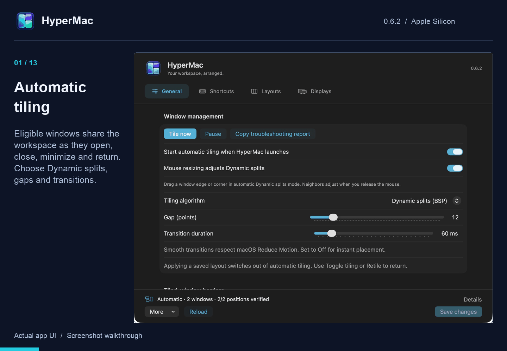
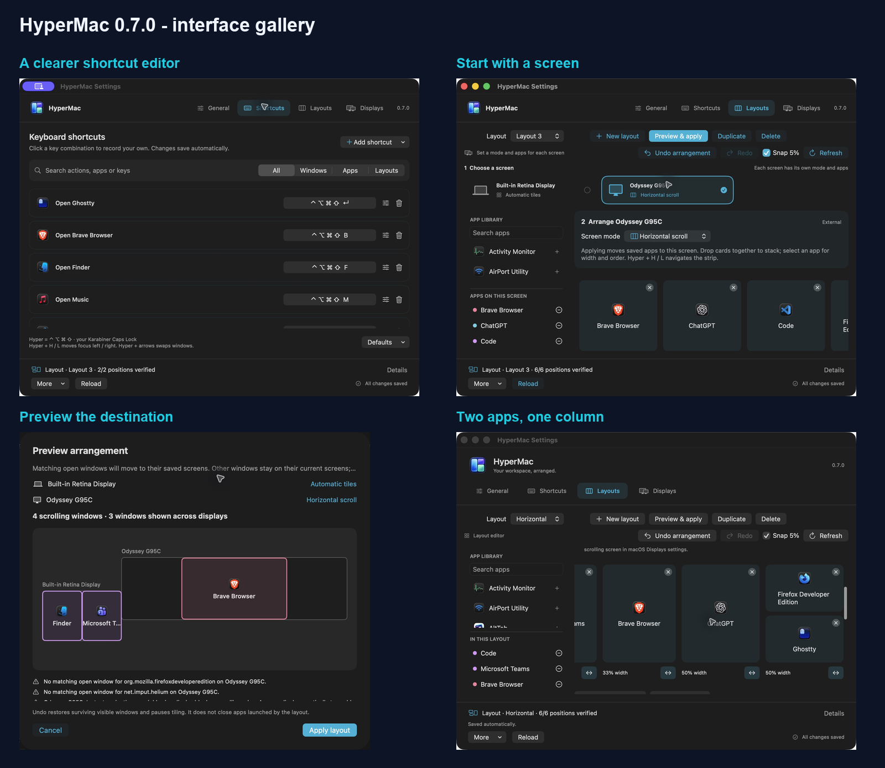

# HyperMac 0.7.0 feature tour

Captured from installed **0.7.0 builds 26–28** on Apple Silicon, on 8 October 2026.



This 80-second looping GIF contains 16 captioned slides. It is a **screenshot walkthrough**, not a recording of window movement or a performance benchmark. Horizontal scrolling is experimental and has not passed visual acceptance on the side-by-side laptop/Odyssey setup. The monitor-profile slide is explicitly labeled as an illustration; docking is not recorded. Undo/redo controls are explained, not demonstrated as a live restoration.

## Current screenshots

These are actual app-window captures. The app content and control states have not been retouched. Some views show inactive-window styling or partially visible content at a scroll boundary. The selected apps, border color, 10-point neighbor space and timings are customized settings, not defaults. Layout diagrams show saved templates, not every live window. No document contents or account pages are included.

| Screenshot | Features |
| --- | --- |
| [Automatic tiling](screenshots/11-general-070.png) | Runtime controls, mouse resizing, gaps and transitions |
| [Focus appearance](screenshots/12-blur-borders-070.png) | Focus-only border, blur Off switch and intensity |
| [Shortcuts](screenshots/26-shortcuts-070.png) | Search, filters, compact action rows and app launchers |
| [Horizontal navigation bindings](screenshots/27-navigation-shortcuts-070.png) | Hyper+H/L and directional focus |
| [Shortcut recorder](screenshots/28-recorder-070.png) | Press a combination; Escape cancels |
| [Normal layout](screenshots/16-normal-layout-070.png) | Adaptive preset, app library, preview and duplicate controls |
| [Horizontal monitor diagram](screenshots/17-horizontal-diagram-070.png) | Screen selector and editable app rectangles |
| [Columns and groups](screenshots/18-horizontal-groups-070.png) | Two apps in one column, width handles and direct × removal |
| [App width inspector](screenshots/19-app-width-070.png) | Width presets, full width, reorder, group and separate |
| [Screen-first editor](screenshots/24-screen-layouts-070.png) | Current screen cards, separate modes and per-screen app lists |
| [Destination preview](screenshots/25-per-screen-preview-070.png) | Odyssey horizontal strip and laptop automatic tiling, drawn on their assigned screens |
| [Scrolling options](screenshots/21-scroll-options-070.png) | Neighbor space, center focus, Hyper-scroll, wrap and timing |



The earlier `01`–`10` screenshots are retained as historical 0.6.2 captures and are not used by the current tour.

## Rebuild

With Python 3 and Pillow installed, run:

```sh
python3 scripts/build-media.py
```

This regenerates the GIF, poster and gallery from the checked-in captures. It does not control the app, change settings or publish anything.

### Screen-first editor update — build 27

[`22-screen-first-layouts-070.png`](screenshots/22-screen-first-layouts-070.png) shows the installed Layouts redesign: visible per-screen mode cards, a shared screen/mode/app selection, a compact header, and the screen's own app list. The tour now includes the updated editor and preview in captures 24–25; the older detail views retain their build-26 chrome. This screenshot demonstrates the editor, not animation smoothness.

[`23-correct-display-preview-070.png`](screenshots/23-correct-display-preview-070.png) shows build 28's corrected Preview & apply destination: the four matching open apps belong to the Odyssey strip; the laptop is left unchanged. Only the fully visible scrolling column is drawn in the monitor preview; the count includes parked columns. Apply was verified with 4/4 actual placements on Odyssey.

### Refreshed tour — build 28

Captures 24–25 show the current per-screen editor and Preview & apply with Odyssey horizontal scrolling and laptop automatic tiling. Captures 26–28 show the current compact Shortcuts page, filtered navigation actions and recorder. Capturing these screens did not apply a layout or change bindings. Other detail images were captured during the documented build-26 feature checks; they remain representative of those controls but use the older header.
